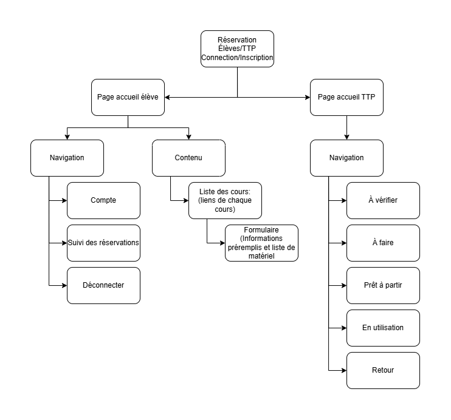
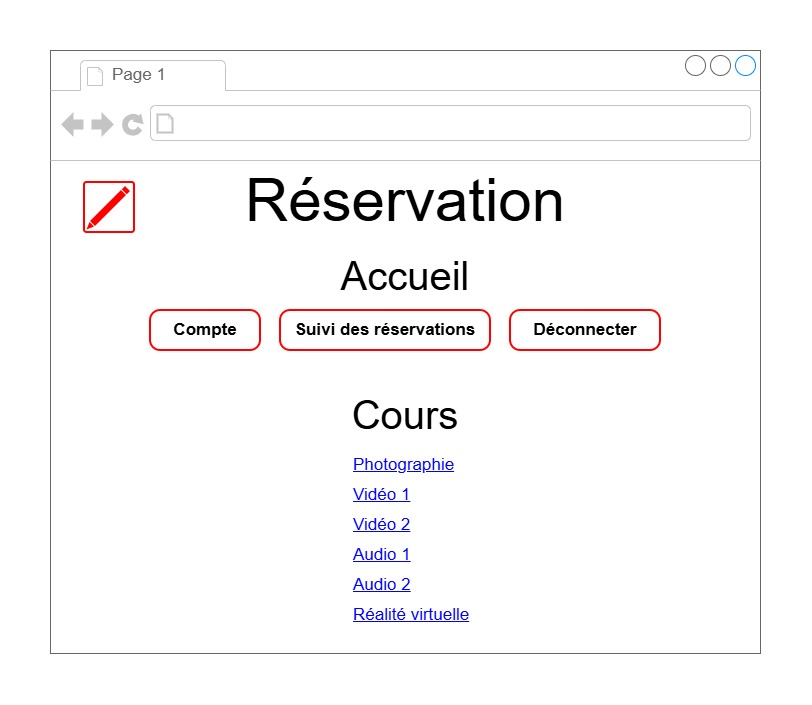

# app-reservation
# Nom de l'application

Projet conçu en équipe avec : Abir Amoucha

## Le problème

- Problème : Les étudiants prennent trop de temps pour trouver le fichier, le télécharger, le renommer, le remplir, calculer le 48h d'avance, copier le lien et finalement l'envoyer.
                - excel non responsive
                - excel pas dispo partout
                - oublier # DA
                - trop d'étapes
                - calculer 48h
                - pas images matériel
                - pas inventaires
                - pas de suivi
- Persona : Les étudiants et le personnel veulent emprunter du matériel rapidement et devoir calculer le 48h les frustre.

## La solution

- Proposition de valeur : C'est rapide, simple et inutile de calculer le 48h d'avance ou de s'en souvenir.
- Fonctionnalités du MVP :
    - En tant qu'élève, je veux réserver du matériel rapidement et facilement afin de ne pas perdre de temps inutilement et de ne rien oublier.
- Solution
            - réservation dans le site directement
            - profil étudiant
            - checklist à nombre
            - auto login
            - calendrier automatisé
            - ajout d'images
            - inventaire (nb restant)
            - suivi avec rappel (24h, 1h-30min avant)
- MVP
            - calendrier automatisé

- Nive to have
            - Accès inventaire

## L'expérience

- Direction artistique : couleurs #000000, #FFFFFF, #FF003A et police Helvetica
- Sur téléphone et sur ordinateur : Sur téléphone, les éléments apparaissent un sous l'autre.

## Le plan de développement

- Technologies et hébergement : HTML, CSS. Le site sera hébergé sur Github, car c'est gratuit. Connexion avec le compte du collège, car c'est lié à l'école.
- Équipe : Gestion de projet, design UX et UI, développement, tests
- Échéancier : Sprint 1: catalogue du matériel des cours - Sprint 2: système de réservation
- Budget : environ 30 000 $
- Mesures du succès : Il y aura moins de réservations en retard et les utilisateurs seront satisfaits de la simplicité et de la rapidité pour réserver.

## La demande

Nous demandons 30 000 $ pour créer un site de réservation simple, rapide et efficace, sans devoir calculer le 48h d'avance, et ce pour les étudiants et le personnel.
